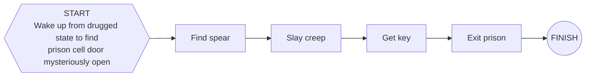
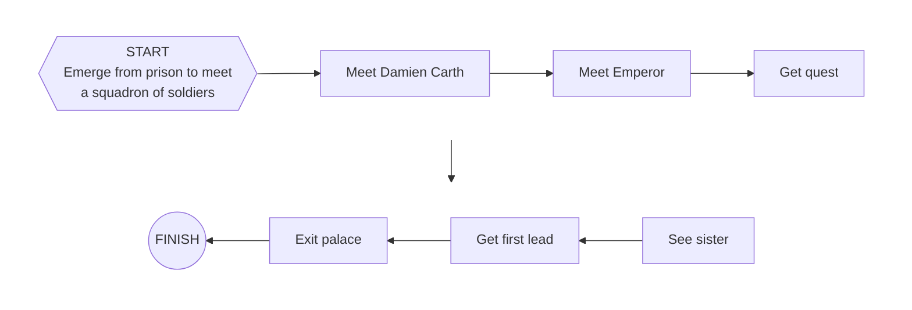

# 6 Story Structure

The story structure has seven main chapters or parts, each of which is illustrated by the activity diagrams below. Within each diagram, the structure is broken down by major activities or quests the player must complete to beat the game. Note that as a result of branching narrative, Part 7 has two subparts. Also note that between quests, the PC generally has an unlimited amount of time to explore unlocked levels or locations.

## 6.1 Part 1: Escape from Prison Darkhenge

Prison Darkhenge is where the game starts. The PC wakes up one day, and the door to the cell is mysteriously open. The PC exits the prison and must find a key to unlock the uppermost door of the prison.

<figure markdown="block">
<figcaption>Figure 1: Activity diagram for escaping from Prison Darkhenge</figcaption>

</figure>

## 6.2 Part 2: Get assassination quest from Emperor

After escaping from the prison, the PC emerges into the palace bailey to find a squadron of soldiers waiting for him. They escort the PC to Emperor Marcus, who then gives the PC the quest to assassinate Samuel the Healer, the living leader of the Calydonians, in exchange for the freedom of the PC and the PC’s sister.

<figure markdown="block">
<figcaption>Figure 2: Activity diagram for getting quest from Emperor Marcus</figcaption>

</figure>

## 6.3 Part 3

Redacted

## 6.4 Part 4

Redacted

## 6.5 Part 5

Redacted

## 6.6 Part 6

Redacted

## 6.7 Part 7

Redacted
