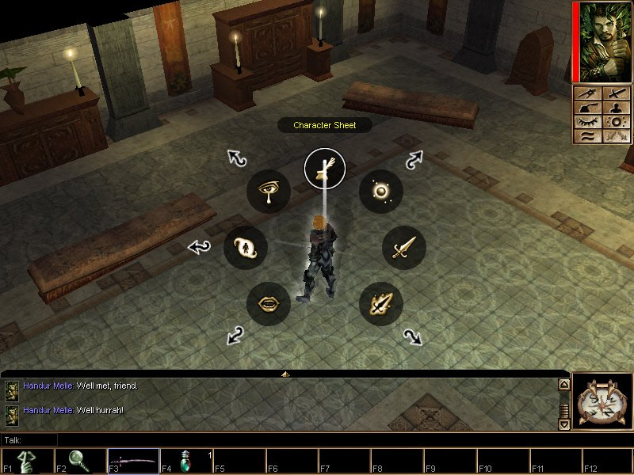
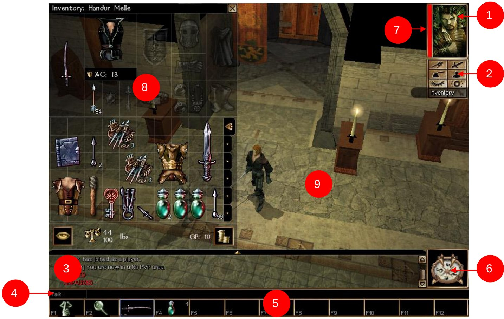

# 7 Interface

The interface through which the player interacts with the game is the same interface used in Neverwinter Nights. This section briefly describes the Radial Menu, the Main Gameplay Screen, and Hotkey Commands.

## 7.1 The Radial Menu

<figure markdown="span">
  { width="420" }
  <figcaption>Figure 3: Radial Menu</figcaption>
</figure>

The PC can display the Radial Menu by pressing the right mouse button on their character or by right-clicking away from their character on any point in the Main Gameplay Screen. When it appears, it shows a ring of possible actions that player can perform. The player clicks the left mouse button to select an action.

## 7.2 The Main Gameplay Screen

The built-in Main Gameplay Screen of the Neverwinter Nights toolset has multiple distinct sections, as depicted in Figure 4.

<figure markdown="span">
  
  <figcaption>Figure 4: Interface that Calydon will use is from the Neverwinter Nights Aurora Toolset</figcaption>
</figure>

The table below describes the primary sections of the Main Gameplay Screen.

| No. | Name             | Description                                                                                                                                                                                   |
|---------|----------------------|---------------------------------------------------------------------------------------------------------------------------------------------------------------------------------------------------|
| 1       | Character Portrait   | Displays picture of the main character.                                                                                                                                                           |
| 2       | Options Box          | Gives access to different screens needed to control the character, such as the journal, map, and inventory.                                                                                       |
| 3       | Chat Window          | Displays messages from in-game events and other NPCs.                                                                                                                                             |
| 4       | Chat Entry Bar       | Allows the player to type chat messages. Not applicable for this game.                                                                                                                            |
| 5       | Quickbar             | Gives the player quick access functions such as spells and items. Each cell in the quickbar has a corresponding hotkey. Players can drag inventory items and spells to the cells in the quickbar. |
| 6       | Compass              | Indicates the direction the character is facing.                                                                                                                                                  |
| 7       | Status Bar           | Displays any special effects, such as a cast spell or a negative effect inflicted on the PC by another.                                                                                           |
| 8       | Inventory            | Displays the character’s equipment. This panel is not always active; it is shown here for explanatory purposes.                                                                                   |
| 9       | Main Gameplay Screen | The main portion of the screen (obviously) where the action takes place.                                                                                                                          |

## 7.3 Hotkey Commands and Panels

Players will be able to click in the interface *as well as* use hotkey commands to bring up the interface panels listed in the table below. These are the panels provided by the Neverwinter Nights interface. (For a list of the corresponding hotkeys for the panels, see [Section 10.1: Controller Configuration](10-gameplay.md#101-controller-configuration).)

| Interface Element | Description                                                                                                                  |
|-----------------------|----------------------------------------------------------------------------------------------------------------------------------|
| Character Panel       | Displays statistics and abilities of the character.                                                                              |
| Skills Sub Panel      | Displays all the character’s skills and modifiers.                                                                               |
| Feats Sub Panel       | Displays information about a special abilities granted by the character’s class and race.                                        |
| Inventory Panel       | Displays the character’s equipment.                                                                                              |
| Spells Panel          | Displays the character’s spellbook panel and spell preparation panel.                                                            |
| Conversation Panel    | Displays portrait of the character that PC is talking with, as well as response options.                                         |
| Map Panel             | Displays aerial (top-down) view of the area the PC is in. Expands as the player explores an area and indicates current location. |
| Journal Panel         | Displays the status of the PC’s quest.                                                                                           |
| Stores Panel          | Displays store items on the left side and player’s inventory on the right side.                                                  |
| Options Panel         | Lets the player customize game options to suit his or her playing style. Includes controls for video, sound, game options, etc.  |
