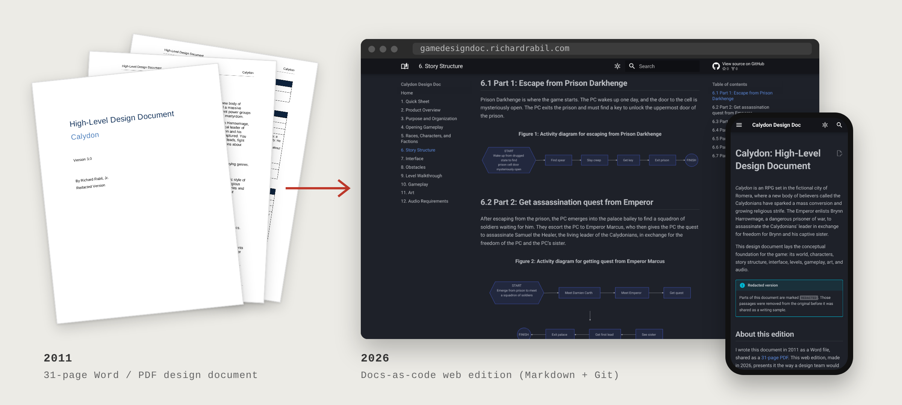

# Calydon: High-Level Design Document

*Calydon* is an RPG set in the fictional city of Romera, where a new body of believers called the Calydonians have sparked a mass conversion and growing religious strife. The Emperor enlists Brynn Harrowmage, a dangerous prisoner of war, to assassinate the Calydonians' leader in exchange for freedom for Brynn and his captive sister.

This design document lays the conceptual foundation for the game: its world, characters, story structure, interface, levels, gameplay, art, and audio.

!!! info "Redacted version"

    Parts of this document are marked Redacted. Those passages were removed from the original before it was shared as a writing sample.

## About this edition

I wrote this document in 2011 as a Word file, shared as a [31-page PDF](PDF_URL_HERE). This web edition, made in 2026, presents it the way a design team would keep a living spec: as plain Markdown files in a Git repository, built into a website by [MkDocs](https://www.mkdocs.org/) with the [Material](https://squidfunk.github.io/mkdocs-material/) theme, and published automatically by GitHub Pages each time a change is saved. The text is unchanged apart from light formatting fixes. The story diagrams in Section 6 are now written as text with [Mermaid](https://mermaid.js.org/), so they can be edited like the rest of the document.

